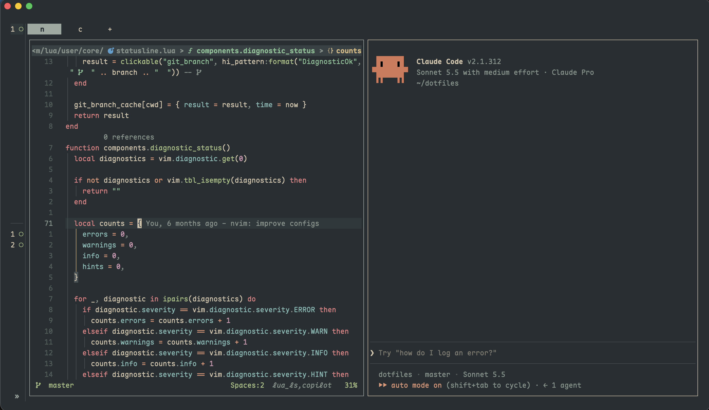
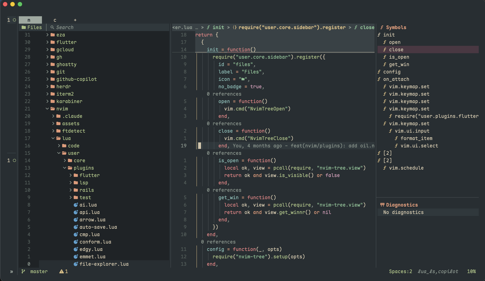
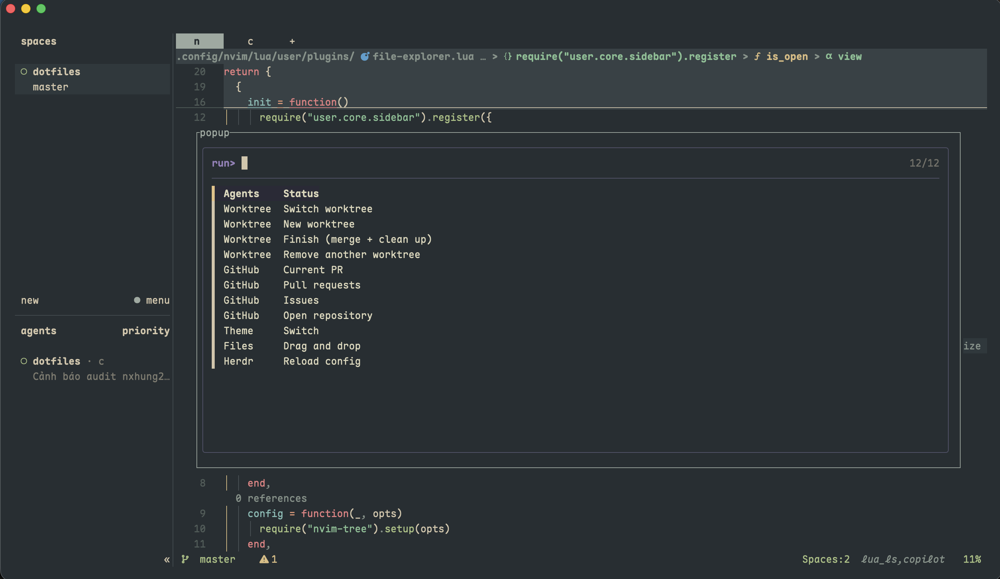
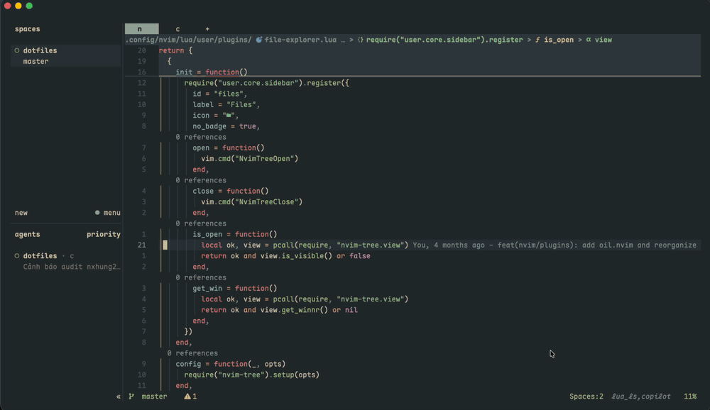

# dotfiles

My macOS development environment: Neovim, Ghostty, Herdr/tmux, Zsh and AI coding assistants (Claude Code, Codex, Gemini) — one repo, one install command, one theme for everything.



## Highlights

- **One command setup** — `./install.sh` walks through each component and asks before installing it.
- **Symlinks via GNU Stow** — edit files in the repo, changes apply instantly.
- **One theme everywhere** — switch Ghostty, Herdr, Neovim, Claude Code and fzf together with `scripts/theme-switch <name>`.
- **Shared AI setup** — Claude Code, Codex and Gemini use the same skills, rules and hooks.
- **Safe by default** — existing configs are backed up to `~/.dotfiles-backup/`, never deleted.

## Install

Requires macOS and git.

```bash
git clone https://github.com/nxhung2304/dotfiles.git ~/dotfiles
cd ~/dotfiles
./install.sh
```

Machine-specific values and secrets go in `~/.env` (sourced by `.zshrc`, never committed), for example:

```bash
export IPHONE_16_UDID="..."
```

## Preview

| Neovim | Herdr |
|--------|-------|
|  |  |



## What's inside

| Area | Path | Notes |
|------|------|-------|
| Editor | `.config/nvim/`, `.vimrc` | Lazy.nvim, LSP, separate setups for VS Code and Xcode |
| Terminal | `.config/ghostty/`, `wezterm/`, `alacritty/` | Ghostty is the daily driver |
| Multiplexer | `.config/herdr/`, `.config/tmux/` | Command palette on `prefix+m`, theme switcher on `prefix+t` |
| Shell | `.zshrc`, `.config/starship.toml` | Oh My Zsh, zoxide, direnv, aliases |
| CLI | `.config/eza/`, `karabiner/`, `git/`, `gh/` | Modern `ls`, key remapping, global gitignore |
| AI | `.claude/`, `.codex/`, `.gemini/` | Agents, skills, hooks and code rules |
| Packages | `Brewfile` | Declarative Homebrew list |
| Scripts | `scripts/` | Installers, sessionizers, theme switcher |

## License

Personal configuration — use anything you like.
